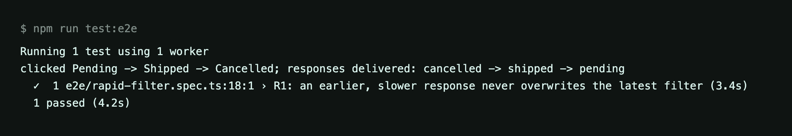
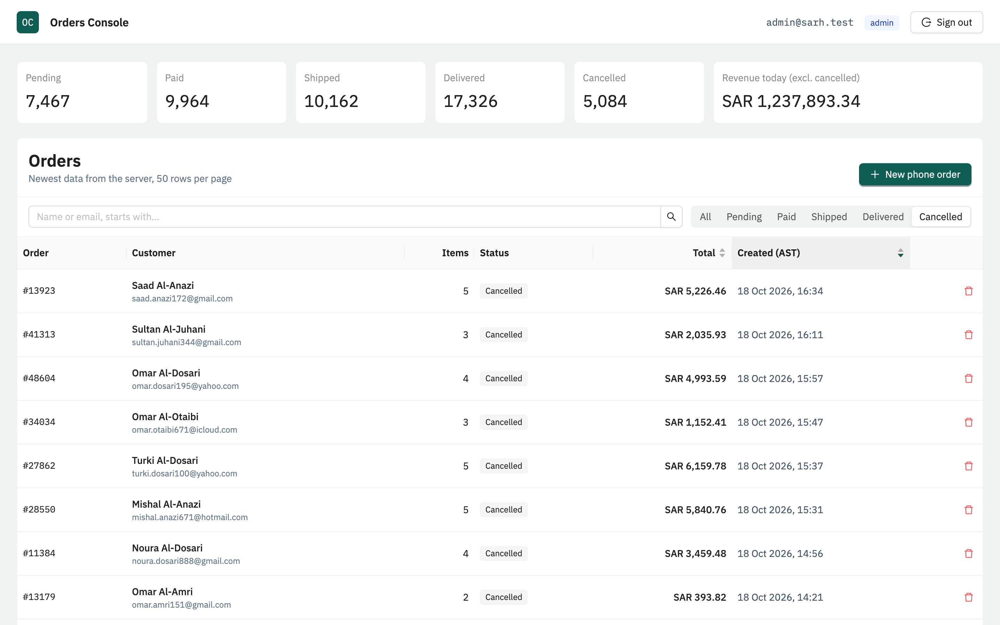
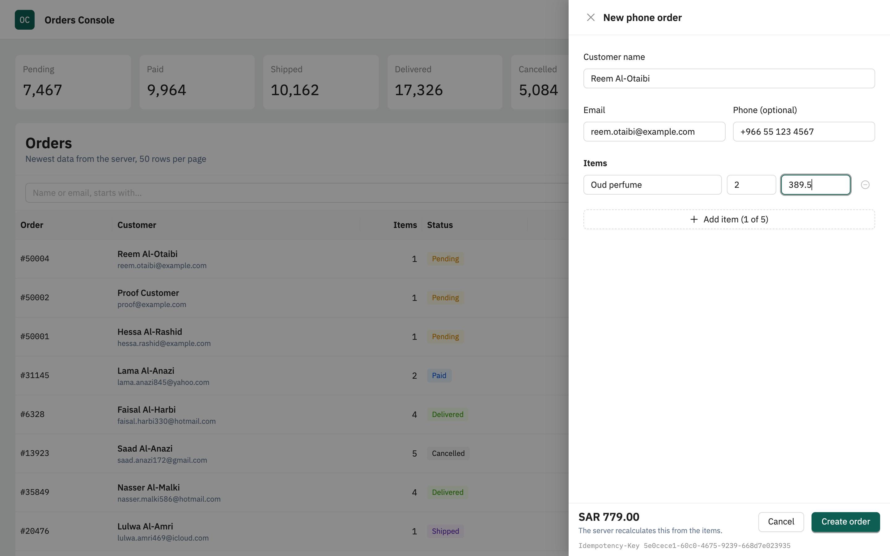
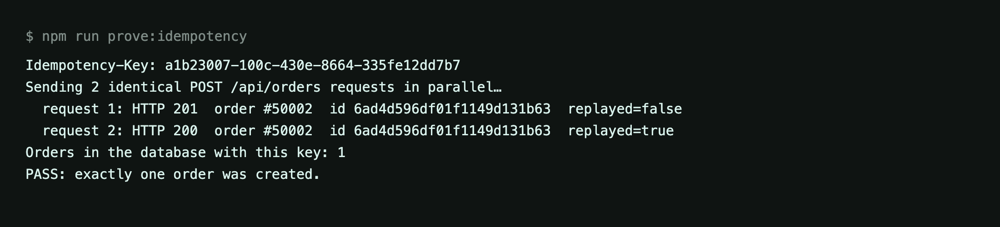

# Orders Console

An operations console for finding orders fast and creating phone orders that can never be duplicated.

**Stack:** React 19 · Ant Design 6 · Tailwind 4 · Express 5 · MongoDB 7 · TypeScript, in one npm-workspaces repo.

[Run it](#run-it) · [Tests](#tests-and-proofs) · [How it works](#how-the-two-hard-problems-are-solved) · [Code review](#code-review-the-contractors-authts) · [Product question](#product-question-delete-all-cancelled-orders) · [Skipped](#what-i-skipped-and-why) · [Screenshots](#screenshots) · [DECISIONS.md](DECISIONS.md) · [SCALE.md](SCALE.md)

## At a glance

| Requirement             | Where it's solved                                                     | Proof                                              |
| ----------------------- | --------------------------------------------------------------------- | -------------------------------------------------- |
| R1 · Fast, correct list | Keyset pagination + compound indexes, TanStack Query keyed by filters | `npm run test:e2e`, `orders.list.test.ts`          |
| R2 · No duplicates      | Idempotency key on the order under a unique index                     | `npm run prove:idempotency`, `idempotency.test.ts` |
| Code review             | Rewritten `requireAuth`, `requireRole`, bcrypt, rate limit            | `auth.test.ts` (one test per finding)              |
| O1 · Slow stats         | 3–6 s endpoint, cancellable request, one Retry                        | Screenshots, by hand                               |

## Project structure

```
apps/api         Express 5 API: routes → controller → service → model
apps/web         React 19 + Vite: Ant Design components, Tailwind layout, TanStack Query
packages/shared  Zod schemas and types used by both, so client and server validate identically
docs/screenshots Evidence for R1 and R2
```

## Run it

**Prerequisites:** Node **20.19+ or 22.12+** (22 recommended; Vite 7 requires it) and **MongoDB 7** on `localhost:27017`, installed locally or started with `npm run db:up` (Docker).

```bash
npm install
cp .env.example apps/api/.env      # then set JWT_SECRET to 32+ random characters
npm run seed                       # 2 users + 50,000 orders, about 3 seconds
npm run dev                        # API on :4000, web on http://localhost:5173
```

Generate a secret with `node -e "console.log(require('crypto').randomBytes(32).toString('hex'))"`. The API refuses to start without one.

| Account           | Password     | Role                      |
| ----------------- | ------------ | ------------------------- |
| `admin@sarh.test` | `Admin#2026` | admin (can delete orders) |
| `agent@sarh.test` | `Agent#2026` | agent                     |

### Settings worth knowing

| Variable                                    | Default     | What it does                                                            |
| ------------------------------------------- | ----------- | ----------------------------------------------------------------------- |
| `STATS_DELAY_MIN_MS` / `STATS_DELAY_MAX_MS` | 3000 / 6000 | How long the stats endpoint waits (O1 asks for 3–6 s)                   |
| `STATS_FAIL_RATE`                           | 0           | Share of stats calls that fail with 503; set `1` to see the error state |
| `JWT_TTL`                                   | 8h          | How long a session lasts                                                |

## Tests and proofs

| Command                     | What it does                                                            |
| --------------------------- | ----------------------------------------------------------------------- |
| `npm test`                  | 29 API tests against a real, temporary mongod (downloaded on first run) |
| `npm run check`             | Typecheck + lint + format check + API tests, all workspaces             |
| `npm run prove:idempotency` | R2 proof against your seeded database                                   |
| `npm run test:e2e`          | R1 browser test (Playwright, uses your installed Chrome)                |

### R2 proof: the same request twice in parallel

`prove:idempotency` signs in as the agent and sends the same `POST /api/orders` twice in parallel with one `Idempotency-Key`:

```
request 1: HTTP 201  order #50001  replayed=false
request 2: HTTP 200  order #50001  replayed=true
Orders in the database with this key: 1
PASS: exactly one order was created.
```

Set `PARALLEL=10` to fire ten at once.

### R1 proof: the browser test

Locally every request is fast and they come back in order, so clicking quickly by hand can't produce "an earlier, slower request". [`e2e/rapid-filter.spec.ts`](apps/web/e2e/rapid-filter.spec.ts) creates that race on purpose:

1. It holds the Pending response for 2 s and the Shipped response for 1 s, and lets Cancelled through at once.
2. It clicks Pending, Shipped, Cancelled 100 ms apart.
3. The responses arrive in the order Cancelled, Shipped, Pending: the stale ones last.
4. It checks the table still shows only Cancelled orders, with the Cancelled filter selected and in the URL.

```
clicked Pending -> Shipped -> Cancelled; responses delivered: cancelled -> shipped -> pending
✓ R1: an earlier, slower response never overwrites the latest filter
```

The test can fail: against a naive `useEffect` fetch with no abort and no "latest wins" guard, stale Pending rows appear under the Cancelled filter.

**Running it:** MongoDB must be running and seeded; the test starts the API and web app if they aren't already running. To use Playwright's own browser instead of Chrome, run `npx playwright install chromium` and set `PW_CHANNEL=chromium`.

## How the two hard problems are solved

### R1: a fast list that never shows stale results

- **Keyset pagination** on `(sort field, _id)`: no `skip`, and no `countDocuments` per request. Pages are fetched as `limit + 1` to know whether another page exists.
- **Targeted active-order indexes**, declared in [`order.model.ts`](apps/api/src/modules/orders/order.model.ts): partial indexes on `{createdAt,_id}`, `{totalMinor,_id}`, `{status,createdAt,_id}`, `{status,totalMinor,_id}`, plus prefix-search indexes on `email` and `nameTokens`, all scoped to `deletedAt: null`.
- **Prefix search** (`/^term/`) on `email` and `nameTokens` uses index bounds. The trade-off: "oura" does not find "Noura".
- **Virtual table:** the browser renders only visible rows and loads the next cursor page on scroll.
- **No stale results:** each filter combination is its own TanStack Query cache entry. A response can only land in the entry it was requested for, and the table always shows the entry for the current filters. The old request is also aborted, but that only saves work; correctness comes from the key. See [`useOrdersQuery.ts`](apps/web/src/features/orders/useOrdersQuery.ts).

### R2: no duplicate orders

- **Client:** creates a UUID `Idempotency-Key` per order being entered. Retries and resubmits reuse it; a new one is issued only after success.
- **Server:** inserts the order with `{createdBy, idempotencyKey}` under a **unique partial index**. A second insert fails with E11000, and the server answers with the first order (200, `Idempotent-Replayed: true`).
- **Same key, different body:** 422.
- **Why it holds:** a single-document insert is atomic, so it needs no transaction and no replica set.

See [`orders.service.ts`](apps/api/src/modules/orders/orders.service.ts). The limits are in [DECISIONS.md](DECISIONS.md).

## Code review: the contractor's `auth.ts`

| #   | Problem                                                                                                                                         | Severity | Fix                                                                           |
| --- | ----------------------------------------------------------------------------------------------------------------------------------------------- | -------- | ----------------------------------------------------------------------------- |
| 1   | `jwt.decode()` never checks the signature: anyone can forge `{"role":"admin"}` or use `alg: none`.                                              | Critical | `jwt.verify()` with `algorithms: ["HS256"]` pinned.                           |
| 2   | `exp` is never checked and `jwt.sign` sets no expiry, so tokens live forever.                                                                   | Security | `expiresIn: JWT_TTL` (default 8h); `verify` enforces it.                      |
| 3   | Secret hard-coded in source (`"sarh-secret-2026"`): anyone with repo access can mint tokens.                                                    | Security | Read from env, validated at startup; exits if missing or under 32 chars.      |
| 4   | Token accepted from `?token=`, so it leaks into logs, browser history and the Referer header.                                                   | Security | Token only from an httpOnly cookie.                                           |
| 5   | Delete has no server-side check ("admin check is done in the React AdminOnly component").                                                       | Security | `requireRole("admin")` returns 403; `AdminOnly` only hides the button.        |
| 6   | Passwords compared in plain text in the query, so they're stored in plain text.                                                                 | Security | bcrypt hashes (`select: false`); find by email, then `bcrypt.compare`.        |
| 7   | NoSQL injection: `{"password": {"$ne": null}}` logs in as anyone. (The original uses Prisma-style syntax; against Mongo this is the real risk.) | Security | Zod parses the body (strings only) before any query.                          |
| 8   | No rate limit on login, so password guessing is free.                                                                                           | Security | `express-rate-limit`: 10 attempts per 15 min per IP.                          |
| 9   | Role trusted from the token: a demoted or deleted user keeps access until it expires (never, here).                                             | Design   | `requireAuth` re-reads the user's role from the database on every request.    |
| 10  | Async handlers with no error handling: under Express 4 a DB error hangs the request.                                                            | Design   | Express 5 forwards async errors to one handler that never leaks stack traces. |
| 11  | `:id` isn't validated, delete returns `{ok:true}` even when nothing matched, and the hard delete leaves no trace.                               | Design   | Invalid id → 400, missing → 404; soft delete with `deletedAt` / `deletedBy`.  |
| 12  | `req.user = payload` with no typing; `requireAuth` isn't reusable for roles.                                                                    | Design   | Typed `req.user`; separate `requireAuth` and `requireRole`.                   |

Every fix has a test in [`auth.test.ts`](apps/api/test/auth.test.ts).

### Where the token lives

In an **httpOnly, SameSite=Strict cookie** scoped to `/api`, served same-origin through the Vite proxy, so page JavaScript never sees it.

- **Protects against:** XSS _stealing_ the token, and cross-site request forgery (SameSite=Strict plus JSON-only endpoints).
- **Doesn't protect against:** XSS _using_ the session while the page is open, since injected script can still call the API as the user. Preventing XSS in the first place (React escaping, no `dangerouslySetInnerHTML`, CSP) still matters.

## Product question: "Delete all cancelled orders"

- **First, why:** what problem do cancelled orders cause today: a cluttered list, slow screens, or storage cost?
- **Who else needs them:** finance for refunds and chargebacks, support for disputes, reporting for cancellation rates, and tax record retention.
- **Who and when:** is a cancelled order ever reopened, and who should be allowed to press the button?
- **If she can't answer:** hide cancelled orders by default instead; the status filter already exists, so they stay one click away.
- **If storage is the real reason:** an admin-only, logged, reversible archive. I wouldn't build a hard delete.

## What I skipped and why

| Skipped                | Why                                                                                                                                                                                                          |
| ---------------------- | ------------------------------------------------------------------------------------------------------------------------------------------------------------------------------------------------------------ |
| O2, optimistic create  | The brief allows only one optional task. I chose O1 (slow stats) because it reuses the request cancellation already built for R1; O2 would need new rollback logic that interacts with duplicate prevention. |
| Total match count      | `countDocuments` on every filter change is the slowest part of a list at scale; the UI shows "N loaded, scroll for more" instead.                                                                            |
| Substring search       | Prefix-only search stays on an index. Substring search needs a text or Atlas Search index (see [SCALE.md](SCALE.md)).                                                                                        |
| Idempotency key expiry | Keys stay on the order forever. Cheap at this size, but a key can never be reused.                                                                                                                           |
| More front-end tests   | The browser suite covers the R1 race only. Create, delete and stats states are covered by API tests and checked by hand.                                                                                     |
| CSRF token             | Relying on SameSite=Strict + same-origin + JSON-only bodies. A cross-origin deployment would need one.                                                                                                       |
| Smaller bundle         | About 420 kB gzipped, mostly antd. Route-level code splitting would fix it but adds nothing to this review.                                                                                                  |
| Gap-free order numbers | The create path re-checks idempotency right before reserving an order number, which reduces avoidable gaps on late retries. Under truly parallel duplicate submissions, small gaps can still occur.           |
| Screen recording       | Screenshots below instead.                                                                                                                                                                                   |

## Screenshots

**R1, the browser test:** responses delivered stale-last, and the table still shows the latest filter.


**R1, the result:** after three quick clicks, only Cancelled orders are shown.


**R2, the create form:** validated with the shared schemas; the Idempotency-Key at the bottom stays the same across retries.


**R2, the duplicate proof:** two identical requests in parallel, one 201, one replayed 200, one order in the database.


More: [orders list](docs/screenshots/01-orders-list.png) · [order created](docs/screenshots/05-order-created.png) · [proof output as text](docs/screenshots/prove-idempotency.txt) · [e2e output as text](docs/screenshots/rapid-filter-e2e.txt)
